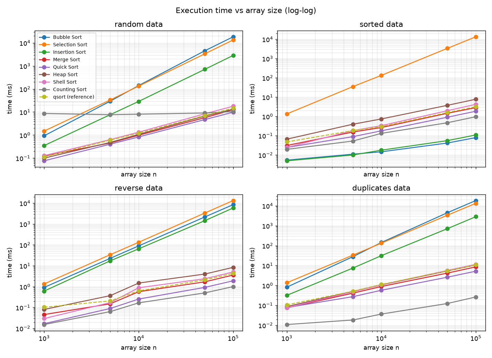
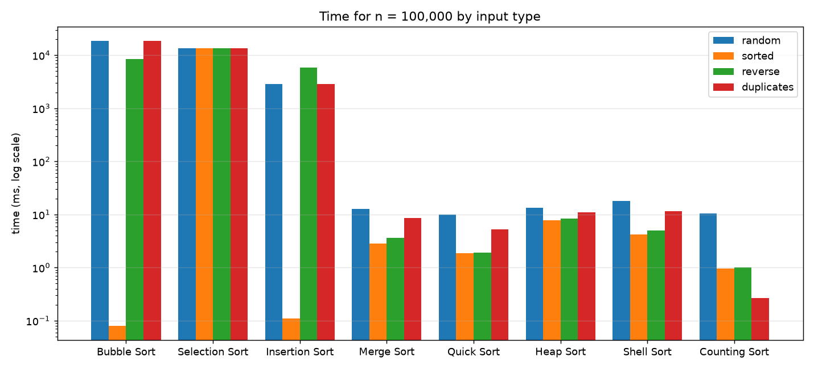
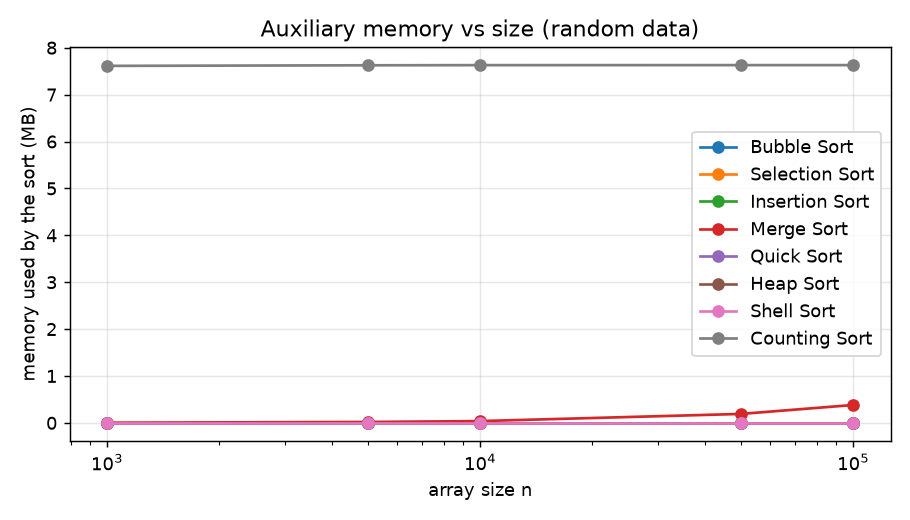

# Sorting Algorithms - Implementation, Performance Measurement and Comparison

**Module:** Algorithms and Data Structures - Université Badji Mokhtar, Annaba (Computer Science Department)
**Instructor:** Dr. Sabri Ghazi
**Author:** `Adham Rashed` - **Group:** `G1` - **Academic year:** `2026–2027`

---

## 1. Language and measurement libraries

| Item | Choice |
|---|---|
| Language | **C** (ISO C11), compiled with `gcc 13.3` (`-O2 -Wall -Wextra -pedantic`) |
| Wall-clock time | `clock_gettime(CLOCK_MONOTONIC)` (POSIX) |
| CPU time | `clock_gettime(CLOCK_PROCESS_CPUTIME_ID)` |
| Memory (system) | `getrusage(RUSAGE_SELF).ru_maxrss` - peak resident set size |
| Memory (exact) | `malloc`/`free` wrappers (`src/memtrack.c`, linker option `--wrap`) - exact peak heap bytes requested by the sort |
| Built-in sort | `qsort()` is used **only as a reference** in the comparison and in the tests, never as one of the eight implemented algorithms |

**Why two memory measures?** `ru_maxrss` is the API suggested by the assignment, but Linux updates the resident-page counters in batches, so it cannot see changes smaller than about 256 KB (a 10 000-element Merge Sort buffer is only 40 KB). The `malloc` wrapper gives the exact figure. The tables show the exact figure in the **Memory (MB)** column and the `getrusage` growth in **RSS+ (MB)**; both are exported to the CSV (`peak_rss_mb` is the whole process peak).

**Measurement method** (`src/benchmark.c`)
- Each algorithm sorts **its own copy** of the **same** input array (generated once per size/type with a fixed seed, `42`).
- Only the call to the sorting function is timed (generation, copy, correctness check and printing are outside the timer).
- Every run is executed in a **fresh child process** (`fork`), so `ru_maxrss` belongs to that single run and not to the whole history of the program.
- Time is the **average of 5 runs**; memory is the **maximum** over the runs.
- Exception: Bubble, Selection and Insertion Sort use **1 run** when n >= 50 000 (a single run already takes seconds).
- After timing, the result is checked with `is_sorted()`; the `OK` column shows it.

## 2. Install, compile and run

Requirements: GNU/Linux with `gcc`, GNU `make`, glibc, and a GNU-compatible linker (`--wrap` is used for heap tracking). Python 3 + matplotlib are needed **only** to regenerate the charts.

```bash
git clone https://github.com/<username>/sorting-algorithms.git
cd sorting-algorithms
make              # builds ./sorting
make run          # interactive menu
make test         # builds and runs the correctness tests
./sorting --big   # big array example (100 000 random integers, seed 42)
./sorting --full  # all input types x all sizes -> results/results.csv
.venv/bin/python tools/plot_results.py   # charts -> results/*.png (optional)
make clean
```

Menu:

```
=========== SORTING ALGORITHMS ===========
1. Bubble Sort      2. Selection Sort    3. Insertion Sort
4. Merge Sort       5. Quick Sort        6. Heap Sort
7. Shell Sort        8. Counting Sort
9. Compare all algorithms     (asks the input type, runs sizes 1 000 ... 100 000, exports results/compare_<type>.csv)
10. Big array example (100 000 integers)
0. Exit
```

For options 1-8 the user chooses the array size (presets or custom) and the input type (random, sorted, reverse, many duplicates). Invalid input (letters, empty line, out-of-range numbers, EOF) never crashes the program. Arrays of 20 elements or fewer are displayed before and after sorting.

## 3. Project structure

```
sorting-algorithms/
├── README.md
├── Makefile
├── .gitignore
├── src/
│   ├── main.c        menu and program entry point
│   ├── sorting.c/.h  the five required and three bonus algorithms (no printing, no measurement)
│   ├── benchmark.c/.h time and memory measurement
│   ├── memtrack.c/.h exact heap accounting (malloc/free wrappers)
│   └── utils.c/.h    reproducible array generation, copy, check, display
├── tests/test_sorting.c   correctness tests (vs qsort, edge cases, 200 000 elements)
├── tools/plot_results.py  chart generation (bonus)
└── results/          results.csv, compare_*.csv, charts, full_run_log.txt
```

## 4. The algorithms

| Algorithm | Best | Average | Worst | Space | Stable | Notes (this implementation) |
|---|---|---|---|---|---|---|
| Bubble Sort | O(n) | O(n²) | O(n²) | O(1) | yes | Early-exit flag: stops when a pass makes no swap, hence O(n) on sorted data |
| Selection Sort | O(n²) | O(n²) | O(n²) | O(1) | no | Always n(n-1)/2 comparisons but at most n-1 swaps |
| Insertion Sort | O(n) | O(n²) | O(n²) | O(1) | yes | Shifts elements instead of swapping; excellent on nearly sorted data |
| Merge Sort | O(n log n) | O(n log n) | O(n log n) | O(n) | yes | Recursive; **one** auxiliary buffer allocated once; recursion depth log₂ n |
| Quick Sort | O(n log n) | O(n log n) | O(n²) | O(log n) stack | no | **Median-of-three pivot** + Hoare partition; recursion only on the smaller part, so depth <= log₂ n |
| Heap Sort | O(n log n) | O(n log n) | O(n log n) | O(1) | no | Max heap, then repeated extraction |
| Shell Sort | depends on gaps | ~O(n²) | O(n²) | O(1) | no | Halving gap sequence |
| Counting Sort | O(n + k) | O(n + k) | O(n + k) | O(k) | yes | Uses a count array when the value range is at most 10,000,000; otherwise uses Quick Sort to avoid impractical allocation |

**Quick Sort pivot strategy.** The pivot is the median of the first, middle and last elements. This avoids the classic O(n²) behaviour of a first/last pivot on sorted and reverse-sorted data (confirmed below: Quick Sort is among the fastest on those inputs). Hoare partitioning splits equal keys evenly, so inputs with many duplicates stay O(n log n). Recursing on the smaller side and looping on the larger one bounds the stack depth by log₂ n, so even 200 000 sorted elements cannot overflow the stack. A contrived adversarial input could still reach O(n²) (a random pivot would remove that risk).

## 5. Experimental results

The following tables are generated from the current `results/results.csv`.
The dataset contains **180 records**: nine algorithms (eight implemented
algorithms plus the `qsort()` reference), four input types, and five array
sizes. Every recorded result passed the sorted-output correctness check.

**Test environment:** GNU/Linux Cloud Shell, GCC 13.3, `-O2`.
Input generation uses seed 42. Random values are in [0, 999 999];
duplicate-heavy values are in [0, 99].

**Run policy:** five runs are used by default. Bubble, Selection, and
Insertion Sort use one run when n >= 50,000. The reported execution time
is the average; memory figures are the maximum measured across the runs.

### 5.1 Wall-clock time

#### Random data — wall-clock time (ms)

| Algorithm | 1000 | 5000 | 10000 | 50000 | 100000 |
|---|---:|---:|---:|---:|---:|
| Bubble Sort | 0.9337 | 29.5764 | 141.3287 | 4542.2921 | 18432.5522 |
| Selection Sort | 1.5012 | 33.5178 | 133.9190 | 3352.6883 | 13465.4398 |
| Insertion Sort | 0.3507 | 7.7004 | 28.9586 | 711.6855 | 2868.5647 |
| Merge Sort | 0.1233 | 0.4560 | 0.9877 | 5.7000 | 12.7870 |
| Quick Sort | 0.0768 | 0.4033 | 0.8318 | 4.7055 | 9.8907 |
| Heap Sort | 0.1002 | 0.4807 | 1.0754 | 6.6757 | 13.3245 |
| Shell Sort | 0.1287 | 0.6355 | 1.3388 | 8.3931 | 17.9481 |
| Counting Sort | 8.7053 | 7.6689 | 8.0877 | 9.1192 | 10.4565 |
| qsort (reference) | 0.1132 | 0.6053 | 1.2185 | 7.0528 | 14.7968 |

#### Sorted data — wall-clock time (ms)

| Algorithm | 1000 | 5000 | 10000 | 50000 | 100000 |
|---|---:|---:|---:|---:|---:|
| Bubble Sort | 0.0054 | 0.0110 | 0.0146 | 0.0417 | 0.0795 |
| Selection Sort | 1.3441 | 35.0619 | 134.0148 | 3382.6006 | 13430.9491 |
| Insertion Sort | 0.0050 | 0.0100 | 0.0178 | 0.0555 | 0.1098 |
| Merge Sort | 0.0310 | 0.1547 | 0.2653 | 1.4522 | 2.8472 |
| Quick Sort | 0.0245 | 0.0893 | 0.1783 | 0.9091 | 1.8538 |
| Heap Sort | 0.0663 | 0.3923 | 0.7382 | 3.7546 | 7.7747 |
| Shell Sort | 0.0245 | 0.1837 | 0.3315 | 1.9735 | 4.2254 |
| Counting Sort | 0.0196 | 0.0528 | 0.1320 | 0.4686 | 0.9651 |
| qsort (reference) | 0.0474 | 0.1843 | 0.2947 | 1.5859 | 3.1936 |

#### Reverse data — wall-clock time (ms)

| Algorithm | 1000 | 5000 | 10000 | 50000 | 100000 |
|---|---:|---:|---:|---:|---:|
| Bubble Sort | 0.9180 | 22.6633 | 89.5145 | 2171.6906 | 8492.2843 |
| Selection Sort | 1.3514 | 34.0024 | 133.6436 | 3359.9185 | 13358.2041 |
| Insertion Sort | 0.6142 | 17.2875 | 64.8162 | 1445.1516 | 5886.7705 |
| Merge Sort | 0.0460 | 0.1504 | 0.5722 | 1.6939 | 3.6040 |
| Quick Sort | 0.0168 | 0.0898 | 0.2537 | 0.9203 | 1.9024 |
| Heap Sort | 0.0810 | 0.3698 | 1.4862 | 3.9999 | 8.3890 |
| Shell Sort | 0.0295 | 0.1718 | 0.8815 | 2.3890 | 5.0386 |
| Counting Sort | 0.0153 | 0.0634 | 0.1673 | 0.5001 | 1.0052 |
| qsort (reference) | 0.1034 | 0.2071 | 0.6258 | 2.1077 | 4.3159 |

#### Duplicates data — wall-clock time (ms)

| Algorithm | 1000 | 5000 | 10000 | 50000 | 100000 |
|---|---:|---:|---:|---:|---:|
| Bubble Sort | 0.8185 | 27.8365 | 143.3477 | 4495.9980 | 18408.3874 |
| Selection Sort | 1.3632 | 33.2823 | 133.0064 | 3366.7868 | 13370.3346 |
| Insertion Sort | 0.3187 | 7.4448 | 31.3000 | 710.6688 | 2843.7063 |
| Merge Sort | 0.0745 | 0.4110 | 0.8849 | 4.1767 | 8.5875 |
| Quick Sort | 0.0777 | 0.2728 | 0.5710 | 2.5981 | 5.1947 |
| Heap Sort | 0.0873 | 0.4997 | 1.0549 | 5.3481 | 10.8466 |
| Shell Sort | 0.0760 | 0.4819 | 1.0745 | 5.6586 | 11.5155 |
| Counting Sort | 0.0109 | 0.0184 | 0.0365 | 0.1240 | 0.2637 |
| qsort (reference) | 0.1061 | 0.5129 | 1.1267 | 5.4449 | 10.9245 |

### 5.2 Exact additional heap memory

The following values come from the `memory_mb` CSV column. They represent
the peak additional heap allocation tracked through the `malloc` wrapper;
they do not include the input array or the process's total memory use.

#### Exact additional heap memory — random data (MiB)

| Algorithm | 1000 | 5000 | 10000 | 50000 | 100000 |
|---|---:|---:|---:|---:|---:|
| Bubble Sort | 0.0000 | 0.0000 | 0.0000 | 0.0000 | 0.0000 |
| Selection Sort | 0.0000 | 0.0000 | 0.0000 | 0.0000 | 0.0000 |
| Insertion Sort | 0.0000 | 0.0000 | 0.0000 | 0.0000 | 0.0000 |
| Merge Sort | 0.0038 | 0.0191 | 0.0381 | 0.1907 | 0.3815 |
| Quick Sort | 0.0000 | 0.0000 | 0.0000 | 0.0000 | 0.0000 |
| Heap Sort | 0.0000 | 0.0000 | 0.0000 | 0.0000 | 0.0000 |
| Shell Sort | 0.0000 | 0.0000 | 0.0000 | 0.0000 | 0.0000 |
| Counting Sort | 7.6133 | 7.6255 | 7.6288 | 7.6293 | 7.6293 |
| qsort (reference) | 0.0000 | 0.0000 | 0.0000 | 0.0000 | 0.0000 |

### 5.3 Understanding the memory columns

- `memory_mb`: peak additional heap bytes requested by the sorting
  algorithm, tracked by the `malloc`/`free` wrappers.
- `rss_growth_mb`: observed increase in resident memory (`ru_maxrss`)
  during the sort. This is an approximate system-level measurement.
- `peak_rss_mb`: peak resident set size of the child process.

The exact heap tracker explains why Counting Sort uses about 7.63 MiB
for random input: the generated values span a range of about one million
integers, and the implementation allocates a `size_t` counter for each
value in that range. With duplicate-heavy values in [0, 99], the required
count array is much smaller.

### 5.4 Charts

Charts can be regenerated with:

```bash
.venv/bin/python tools/plot_results.py
```







## 6. Critical analysis

**Quadratic algorithms.** Bubble, Selection, and Insertion Sort become
much slower as the array grows on random and reverse-sorted data.
Selection Sort remains quadratic even on sorted input because it still
scans the unsorted portion to find the minimum. Bubble and Insertion
Sort benefit greatly from already-sorted input because their early-exit
or insertion behaviour reduces the work.

**O(n log n) comparison algorithms.** Merge, Quick, and Heap Sort scale
much better than the quadratic algorithms on large random inputs.
In this run, Quick Sort recorded 9.8907 ms at 100,000 random elements;
Merge Sort recorded 12.7870 ms and Heap Sort 13.3245 ms. These are
measurements from this machine, not universal performance guarantees.

**Counting Sort depends on the value range.** It was particularly fast
for duplicate-heavy data (0.2637 ms at 100,000 elements) and for sorted
and reverse input. On random data its count array required about 7.63 MiB
and its time was 10.4565 ms. Its complexity depends on both n and the
value range k: O(n + k) time and O(k) additional space. If the range
exceeds 10,000,000, or allocation fails, this implementation falls back
to Quick Sort.

**Memory trade-offs.** Merge Sort allocates an auxiliary array whose size
grows linearly with n. Counting Sort allocates a counter array based on
the input value range. Bubble, Selection, Insertion, Heap, and Shell Sort
do not request additional heap memory in these implementations. Quick
Sort uses recursion stack space, which is not counted by the heap wrapper.

**Fairness and limitations.** Each algorithm receives its own copy of
the same generated input. Array generation, copying, and correctness
checking are outside the timed region. Every measurement runs in a fresh
child process. The slow quadratic algorithms use one run for the two
largest sizes, so those measurements have less averaging than the others.
Results can vary with hardware, system load, compiler, and optimisation.

**Recorded ranking at n = 100,000 (random):** qsort (reference) (rank 0), Quick Sort (rank 1), Counting Sort (rank 2), Merge Sort (rank 3), Heap Sort (rank 4), Shell Sort (rank 5), Insertion Sort (rank 6), Selection Sort (rank 7), Bubble Sort (rank 8).

**Recorded ranking at n = 100,000 (sorted):** qsort (reference) (rank 0), Bubble Sort (rank 1), Insertion Sort (rank 2), Counting Sort (rank 3), Quick Sort (rank 4), Merge Sort (rank 5), Shell Sort (rank 6), Heap Sort (rank 7), Selection Sort (rank 8).

**Recorded ranking at n = 100,000 (reverse):** qsort (reference) (rank 0), Counting Sort (rank 1), Quick Sort (rank 2), Merge Sort (rank 3), Shell Sort (rank 4), Heap Sort (rank 5), Insertion Sort (rank 6), Bubble Sort (rank 7), Selection Sort (rank 8).

**Recorded ranking at n = 100,000 (duplicates):** qsort (reference) (rank 0), Counting Sort (rank 1), Quick Sort (rank 2), Merge Sort (rank 3), Heap Sort (rank 4), Shell Sort (rank 5), Insertion Sort (rank 6), Selection Sort (rank 7), Bubble Sort (rank 8).
## 7. Tests

The test suite was run on GNU/Linux using `make test`.

**Result: 650 checks, 0 failures. All tests passed.**

The tests cover empty and one-element arrays, two- and three-element
arrays, negative numbers, `INT_MIN` and `INT_MAX`, and arrays containing
only equal values. They also cover all four input types at sizes from
3 to 5,000 with three seeds, plus 200,000 elements for the five
non-quadratic algorithms.

## 8. Bonus items covered

The three bonus sorting algorithms are Heap Sort, Shell Sort, and Counting Sort. The project also includes unit/correctness tests, automatically generated charts, comparison with built-in `qsort()`, four input types, and exact heap tracking.
